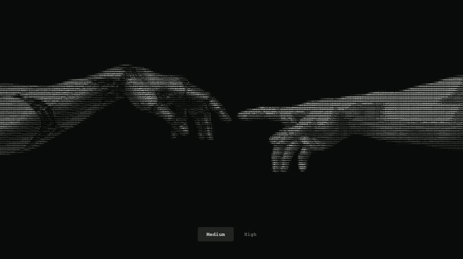

# ASCII — The Creation of Adam

A human hand and a robotic hand reaching toward each other, drawn entirely with printable ASCII characters. A small, dependency-free web component for any website.



[Watch the video](docs/preview.mp4) · [Standalone HTML](preview.html)

## Features

- Two densities: **medium** (360 columns) and **high** (520 columns).
- Subtle continuous movement, pointer lighting, and a spark on activation.
- Original hand pose and shading preserved from the source artwork.
- Responsive, with lower character counts in narrow containers.
- Respects reduced-motion preferences; suspends animation offscreen and in hidden tabs.
- Isolated styles, multiple independent instances, and automatic cleanup when removed.
- No runtime dependencies, fonts, image requests, WebGL, or external services.
- Includes TypeScript declarations and an MIT license.

## Add it to a website

Copy [`dist/ascii-creation.js`](dist/ascii-creation.js) into your site:

```html
<script type="module" src="./ascii-creation.js"></script>

<ascii-creation density="medium"></ascii-creation>
```

That is the complete setup. The script registers the element and contains its artwork data. Serve the page over HTTP, as with any external JavaScript module.

The element fills its container. Set a maximum width with ordinary CSS:

```css
ascii-creation {
  display: block;
  max-width: 1200px;
  margin-inline: auto;
}
```

### Use with a bundler

Install the tagged release from GitHub:

```sh
npm install github:gorkemblm/ascii-the-creation-of-adam#v1.0.0
```

Import it once in your browser entry point:

```js
import 'ascii-the-creation-of-adam';
```

Then use `<ascii-creation>` in your HTML. The package is not required for the copy-and-paste setup above.

## API

```html
<ascii-creation density="high" paused></ascii-creation>
```

| Attribute | Default | Behavior |
| --- | --- | --- |
| `density` | `medium` | `medium` or `high`; updates immediately. |
| `paused` | absent | Pauses continuous motion. Activation resumes it unless reduced motion is enabled. |

```js
const art = document.querySelector('ascii-creation');
await art.ready;

art.density = 'high';
art.pause();
art.play();
art.spark();

const text = art.toText(); // The current printable ASCII grid.
```

`ready` resolves when the connected component has initialized. The element also emits `ready` and `error` events. Invalid density attributes fall back to `medium`; invalid density property assignments throw a `RangeError`.

The artwork supports pointer, touch, Enter, and Space activation. Keyboard handling stays inside the focused component. With reduced motion enabled, the hands remain still and activation produces a brief static highlight.

The runtime requires a browser with Canvas 2D, custom elements, `ResizeObserver`, `IntersectionObserver`, and `DecompressionStream` support.

## Run the demo

Requires Node.js 18 or newer. No dependency installation is needed.

```sh
npm run dev
```

Open [localhost:5173](http://localhost:5173). The demo contains only the artwork and two density options.

To preview without a server, download `preview.html` and open it in a browser.

## Build

```sh
npm run build
```

This produces:

- `dist/ascii-creation.js` — a single ES module with embedded artwork data.
- `dist/ascii-creation.d.ts` — TypeScript declarations.
- `preview.html` — a self-contained demo that also opens directly from disk.

`npm pack` builds a small package containing the distribution files, README, and license. Source modules, demo files, and documentation media stay outside the package.

## How it works

A grayscale luminance map is decoded into two offscreen hand layers. The renderer samples each character cell, chooses an ASCII glyph and brightness, and draws it with Canvas 2D. The visible artwork contains text glyphs rather than a displayed raster image. Both hand layers move gently without changing their anatomy; individual finger bending is not simulated.

The design is inspired by Michelangelo's *The Creation of Adam*. The hand artwork was developed with AI assistance.

## License

[MIT](LICENSE) © 2026 gorkemblm.
